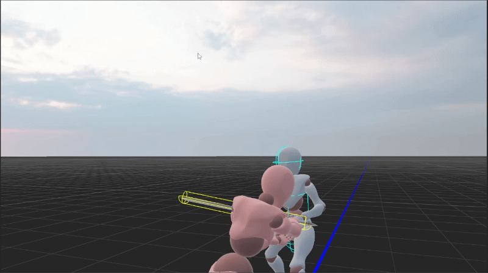
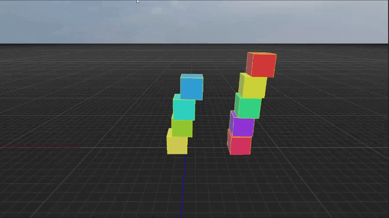

# \# Lengine

# 

# \*\*Lengine is a C++17 3D game engine built from scratch, focused on real-time rendering, graphics programming, and game-engine architecture.\*\*

# 

# 

# &#x20; 

# 

### Custom Animation Blending

  

### Nvidia PhysX Integration

  

